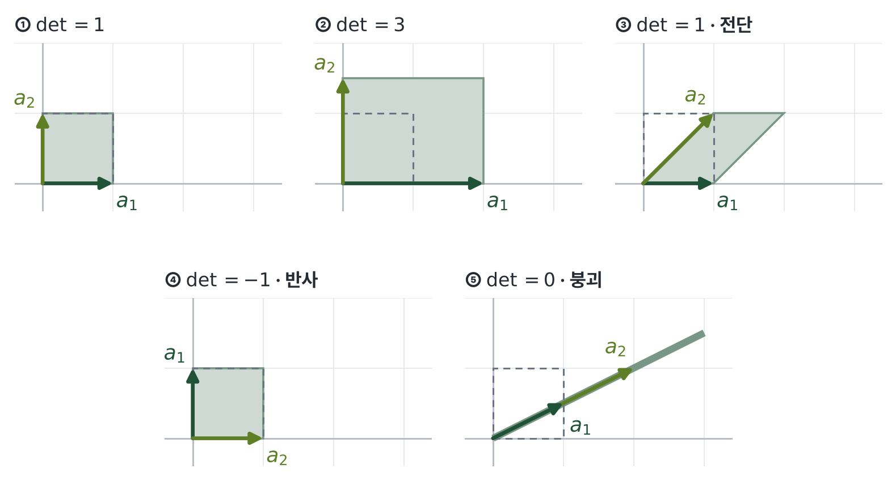

# 그림 생성

본문 개념 그림은 전부 이 폴더의 스크립트로 만듭니다. 장마다 스크립트 하나가 `images/chNN/`에 그림을 저장합니다.

```bash
cd figs
python3 ch07.py                          # 한 장만
for f in ch*.py; do python3 "$f"; done   # 전부
```

- `medfig.py` … 공용 스타일(course-figures). 맨 위 `THEME = "forest"`가 사이트 테마색(`assets/html.css`의 `--course-accent` #1F5236)
- `lafig.py` … 좌표평면 도구: `plane`(인치 단위 배치, 패널끼리 같은 축척), `vec`, `line`(패널 안쪽만 그림), `dot`, `tag`, `out`
- `chNN.py` … 그림 하나당 함수 하나, 함수 이름 = 그림 파일명
- 필요: `numpy`, `matplotlib`, Pretendard 글꼴(`~/.fonts/Pretendard-*.otf`)

그리는 규칙

- 글자는 한글 Pretendard, 11pt 이상. 그림 폭은 8.5인치 이하
- 그림 안에 제목을 넣지 않음. 패널 구분은 `① 짧은 표시`까지만, 설명은 qmd 캡션에
- 칸은 단색(그라데이션·반투명 없음). 나란한 항목은 `CAT`, 순서 있는 단계는 `ramp(n)`
- 강조색(`ACCENT`, 앰버)은 그림 하나에 많아야 한 곳
- 캡션의 `width`는 그림 폭 W인치에 맞춰 `min(100, W/8.5×100)%` … 본문 칸에서 글자가 11px 안팎으로 보이게
- 설명용 가상 데이터로 그린 그림은 캡션에 "설명용"이라고 적음

본문에서 참조하는 형식:

```markdown
{fig-align="center" width="94%"}
```
